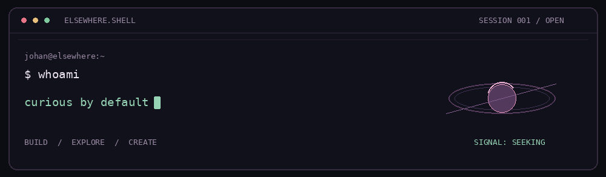
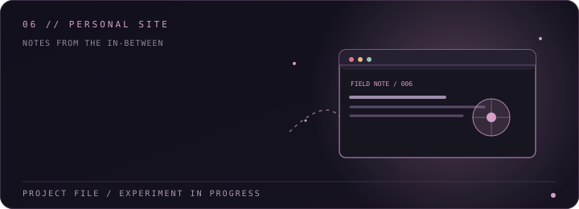

<div align="center">

<a id="top"></a>


<br>

<h1>JOHAN ROHITH</h1>

<h3><code>developer</code> &nbsp;·&nbsp; <code>creator</code> &nbsp;·&nbsp; <code>explorer</code></h3>

<strong>Building things. Following ideas. Seeing where they lead.</strong>

<a href="https://johanrohith.me"></a>
<a href="https://github.com/johanrohith"></a>
<a href="https://x.com/johanrohith"></a>

<sub><a href="#about">[ 01 / ABOUT ]</a> &nbsp; · &nbsp; <a href="#work">[ 02 / WORK ]</a> &nbsp; · &nbsp; <a href="#coordinates">[ 03 / COORDINATES ]</a> &nbsp; · &nbsp; <a href="#hidden-door">[ 04 / HIDDEN DOOR ]</a></sub>

</div>



<div align="center">

`STATUS: EXPLORING` &nbsp; / &nbsp; `LOCATION: SOMEWHERE BETWEEN LOGIC & IMAGINATION`

</div>

---

<a id="about"></a>
<table>
<tr>
<td width="58%" valign="middle">

<h2><code>01</code> &nbsp; A little context</h2>

I'm a BCA student who likes making ideas tangible — from small web experiments to complete project concepts.

I don't want to fit one label. I'm here for <strong>the build, the story, the rabbit hole, and whatever I discover along the way.</strong>

</td>
<td width="42%" valign="middle">


<div align="center">
<sub>Tools in the current orbit · always learning</sub>
</div>

</td>
</tr>
</table>

<a id="work"></a>
## `02` &nbsp; Things I've sent into the world

Not a list of technologies. Small worlds, useful tools, and experiments with a reason to exist.

<table>
<tr>
<td width="50%" valign="top">
<a href="https://github.com/johanrohith/forest-explorer"></a>
<h3><a href="https://github.com/johanrohith/forest-explorer">Forest Explorer ↗</a></h3>
A quiet first-person forest. No rush. Just step into the trees.

<sub>EXPLORATION &nbsp; / &nbsp; GAME</sub>
</td>
<td width="50%" valign="top">
<a href="https://eco-count.github.io/"></a>
<h3><a href="https://eco-count.github.io/">Eco Count ↗</a></h3>
A project about making plastic use visible and helping people think about what comes next.

<sub>WEB &nbsp; / &nbsp; ENVIRONMENT</sub>
</td>
</tr>
<tr>
<td width="50%" valign="top">
<a href="https://github.com/johanrohith/terrawise"></a>
<h3><a href="https://github.com/johanrohith/terrawise">Terrawise ↗</a></h3>
Explore India's soils, crops, and fertilisers through an agriculture-focused intelligence concept.

<sub>AGRICULTURE &nbsp; / &nbsp; DISCOVERY</sub>
</td>
<td width="50%" valign="top">
<a href="https://github.com/johanrohith/liora"></a>
<h3><a href="https://github.com/johanrohith/liora">Liora ↗</a></h3>
A personal operating environment concept — everyday tools in one considered space.

<sub>PRODUCT THINKING &nbsp; / &nbsp; WEB</sub>
</td>
</tr>
<tr>
<td width="50%" valign="top">
<a href="https://github.com/johanrohith/mccreloop"></a>
<h3><a href="https://github.com/johanrohith/mccreloop">MCC ReLoop ↗</a></h3>
A campus reuse platform built around one idea: waste less, loop more.

<sub>CAMPUS &nbsp; / &nbsp; CIRCULAR REUSE</sub>
</td>
<td width="50%" valign="top">
<a href="https://johanrohith.me"></a>
<h3><a href="https://johanrohith.me">My little corner of the internet ↗</a></h3>
A home for my work, notes, experiments, and the next thing I'm figuring out.

<sub>PERSONAL SITE &nbsp; / &nbsp; WORK IN PROGRESS</sub>
</td>
</tr>
</table>

<a id="coordinates"></a>
## `03` &nbsp; Current coordinates

<table>
<tr>
<td width="33%" align="center">

<br><sub>Make useful things.</sub>
</td>
<td width="33%" align="center">

<br><sub>Follow the question.</sub>
</td>
<td width="33%" align="center">

<br><sub>Leave something behind.</sub>
</td>
</tr>
</table>

I'm learning by building, polishing the details, and publishing the work so other people can find it. The route is allowed to change; staying curious is the constant.

---

<a id="hidden-door"></a>
<div align="center">

<h3><code>04</code> &nbsp; You found a door.</h3>

<sub>Most people scroll past this.</sub>

</div>

<details>
<summary><code>./open-the-quiet-door</code> &nbsp; <sup>↳ execute</sup></summary>

```text
ACCESS GRANTED // NO KEY REQUIRED

      .       *       .
   *      keep going      *
       .      .      .

Not every idea needs a roadmap.
Not every experiment needs an audience.
Sometimes curiosity is enough to begin.

$ echo "see you out there"
see you out there.
```


</details>

<div align="center">

<sub>━━━━━━━━━━━━━━━━━━━━━━━━━━━━━━━━━━━━━━━━━━━━━━━━━━━━━━━━━━━━━━━━━━━━</sub>

<sub>Made with curiosity, not a template. &nbsp; · &nbsp; <a href="https://johanrohith.me">johanrohith.me</a></sub>

</div>
