<strong>PROJECTS</strong>

  <a href="https://github.com/johanrohith/forest-explorer"><kbd></kbd></a>

  <a href="https://github.com/johanrohith/eco-count"><kbd></kbd></a>

  <a href="https://github.com/johanrohith/terrawise"><kbd></kbd></a>

  <a href="https://github.com/johanrohith/liora"><kbd></kbd></a>

  <a href="https://github.com/johanrohith/mccreloop"><kbd></kbd></a>

<strong>FIND ME ELSEWHERE</strong>

`johanrohith@astra:~$` — made with curiosity.

