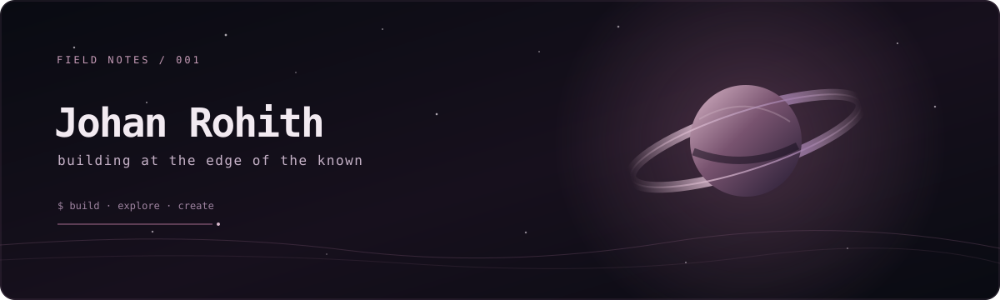

<div align="center">



<br/>

**developer · creator · explorer**

*I build things, follow interesting ideas, and see where they lead.*

[work](#selected-work) · [now](#currently) · [elsewhere](https://johanrohith.me)

</div>

---

```text
johan@elsewhere:~$ whoami
```

I'm Johan — a BCA student who likes turning ideas into things people can use.
Some days that means building a website. Some days it's a small game, an experiment,
or an idea that refuses to stay in my notes.

I don't have one fixed lane. I'm interested in what happens where **code, curiosity,
and creativity** meet.

## `/work` — selected work

<table>
<tr>
<td width="50%" valign="top">

### [Forest Explorer](https://github.com/johanrohith/forest-explorer)

A quiet first-person forest to wander through.

`game` · `exploration`

</td>
<td width="50%" valign="top">

### [Eco Count](https://eco-count.github.io/)

A web project exploring plastic counting and more mindful choices.

`web` · `environment`

</td>
</tr>
<tr>
<td width="50%" valign="top">

### [Terrawise](https://github.com/johanrohith/terrawise)

An agriculture intelligence concept for exploring soils, crops, and fertilisers in India.

`agriculture` · `research`

</td>
<td width="50%" valign="top">

### [Liora](https://github.com/johanrohith/liora)

A personal operating environment — bringing everyday tools into one place.

`product design` · `web`

</td>
</tr>
<tr>
<td width="50%" valign="top" colspan="2">

### [MCC ReLoop](https://johanrohith.me/mccreloop)

A campus reuse platform built around a simple idea: waste less, loop more.

`campus` · `reuse`

</td>
</tr>
</table>

## `/currently` — in progress

- Learning by building and refining real projects.
- Exploring better ways to design useful, thoughtful web experiences.
- Collecting ideas that might become something more.

## `/elsewhere`

[Personal site](https://johanrohith.me) · [GitHub](https://github.com/johanrohith)

---

<details>
<summary><code>./open-the-quiet-door</code></summary>

```text
you found it.

not every idea needs a roadmap.
not every experiment needs an audience.
sometimes curiosity is enough to begin.

keep exploring.
```

</details>

<div align="center">

<sub>Made with curiosity, not a template.</sub>

</div>
