---

### `/projects`

<table>
<tr>
<td width="160" valign="middle">

</td>
<td valign="middle">
<strong><a href="https://github.com/johanrohith/forest-explorer">Forest Explorer ↗</a></strong> 
A quiet, first-person forest to wander through.
</td>
</tr><tr>
<td width="160" valign="middle">

</td>
<td valign="middle">
<strong><a href="https://eco-count.github.io/">Eco Count ↗</a></strong> 
Track plastic use and explore ways to reduce waste.
</td>
</tr><tr>
<td width="160" valign="middle">

</td>
<td valign="middle">
<strong><a href="https://github.com/johanrohith/terrawise">Terrawise ↗</a></strong> 
Explore Indian soils, crops, and fertilisers.
</td>
</tr><tr>
<td width="160" valign="middle">

</td>
<td valign="middle">
<strong><a href="https://github.com/johanrohith/liora">Liora ↗</a></strong> 
A personal environment connecting everyday tools.
</td>
</tr><tr>
<td width="160" valign="middle">

</td>
<td valign="middle">
<strong><a href="https://github.com/johanrohith/mccreloop">MCC ReLoop ↗</a></strong> 
A campus reuse platform: waste less, loop more.
</td>
</tr>
</table>

### `/network`

`johanrohith@astra:~$` — made with curiosity.

