<div align="center">



</div>

<div align="center">

[**Personal site**](https://johanrohith.me) &nbsp;·&nbsp; [**GitHub**](https://github.com/johanrohith)

</div>

---

### `/projects` — things I've been building

<table>
  <tr>
    <td width="50%" valign="top">

**[Forest Explorer](https://github.com/johanrohith/forest-explorer)**

A quiet first-person forest to wander through.

`exploration` · `game`

</td>
    <td width="50%" valign="top">

**[Eco Count](https://eco-count.github.io/)**

A project exploring plastic counting and more mindful choices.

`web` · `environment`

</td>
  </tr>
  <tr>
    <td width="50%" valign="top">

**[Terrawise](https://github.com/johanrohith/terrawise)**

Exploring soils, crops, and fertilisers for agriculture in India.

`agriculture` · `research`

</td>
    <td width="50%" valign="top">

**[Liora](https://github.com/johanrohith/liora)**

A personal operating environment for everyday tools and ideas.

`product` · `experiments`

</td>
  </tr>
  <tr>
    <td colspan="2" valign="top">

**[MCC ReLoop](https://johanrohith.me/mccreloop)**

A campus reuse platform built around a simple idea: waste less, loop more.

`campus` · `reuse`

</td>
  </tr>
</table>

<details>
<summary><code>johanrohith@astra:~$ ./open-the-quiet-door</code></summary>

```text
you found it.

not every idea needs a roadmap.
not every experiment needs an audience.
sometimes curiosity is enough to begin.

keep exploring.
```

</details>

<div align="center">

<sub>Made with curiosity, not a template.</sub>

</div>
