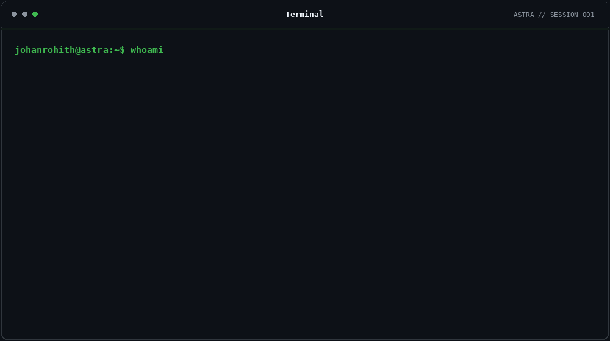
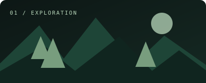
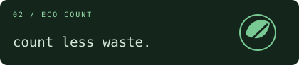
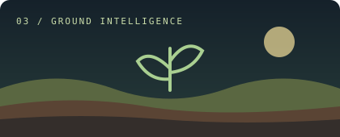
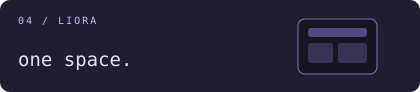
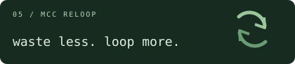

<div align="center">



</div>

<table>
<tr>
<td width="190" valign="top">

### `johanrohith@astra`

```text
/
├─ about
├─ projects
└─ network
```

**[ /about ](#about)**

**[ /projects ](#projects)**

**[ /network ](#network)**

</td>
<td valign="top">

<a id="about"></a>

### `/about` — a little about me

I explore ideas, build things and create beyond code.  
From web projects to creative stories,  
I'm always curious about what my idea can become.

<br/>

<a id="projects"></a>

### `/projects` — selected worlds

<table>
<tr>
<td width="50%" valign="top">

<a href="https://github.com/johanrohith/forest-explorer"></a>

**[Forest Explorer ↗](https://github.com/johanrohith/forest-explorer)**

<sub>A quiet first-person forest to wander through.</sub>

</td>
<td width="50%" valign="top">

<a href="https://eco-count.github.io/"></a>

**[Eco Count ↗](https://eco-count.github.io/)**

<sub>Exploring plastic counting and more mindful choices.</sub>

</td>
</tr>
<tr>
<td width="50%" valign="top">

<a href="https://github.com/johanrohith/terrawise"></a>

**[Terrawise ↗](https://github.com/johanrohith/terrawise)**

<sub>Soils, crops, and fertilisers for agriculture in India.</sub>

</td>
<td width="50%" valign="top">

<a href="https://github.com/johanrohith/liora"></a>

**[Liora ↗](https://github.com/johanrohith/liora)**

<sub>A personal operating environment for everyday tools and ideas.</sub>

</td>
</tr>
<tr>
<td colspan="2" valign="top">

<a href="https://johanrohith.me/mccreloop"></a>

**[MCC ReLoop ↗](https://johanrohith.me/mccreloop)**

<sub>A campus reuse platform built around a simple idea: waste less, loop more.</sub>

</td>
</tr>
</table>

<a id="network"></a>

### `/network` — find me elsewhere

[ GitHub](https://github.com/johanrohith) &nbsp;&nbsp; · &nbsp;&nbsp; [ LinkedIn](https://www.linkedin.com/) &nbsp;&nbsp; · &nbsp;&nbsp; [ X](https://x.com/)

</td>
</tr>
</table>

---

<div align="center">

<sub>`johanrohith@astra:~$` — made with curiosity, not a template.</sub>

</div>
